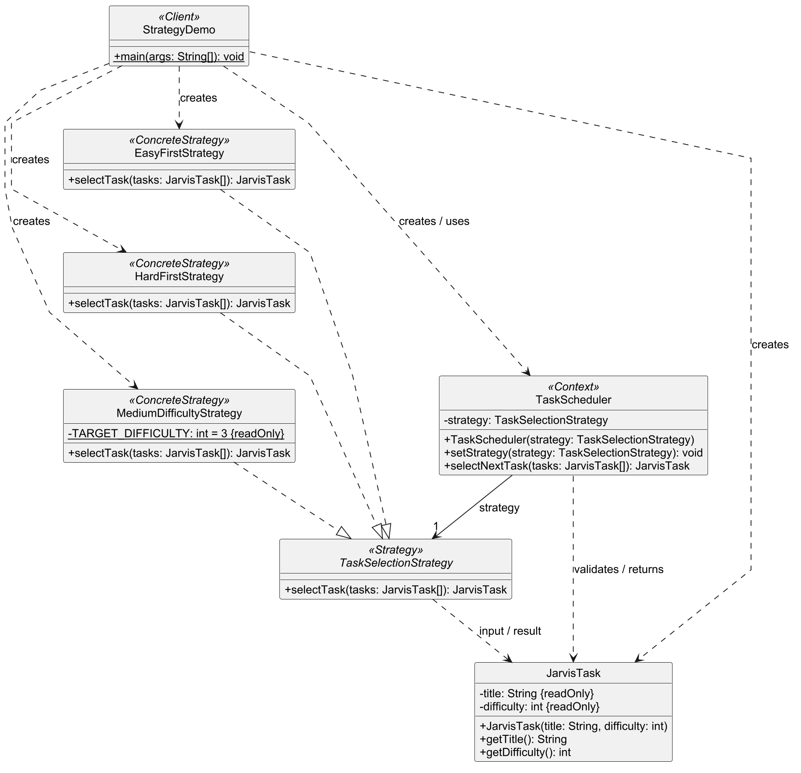

# Assignment 5 — Strategy Pattern

Allazhar Kuat · SE-2515 · Java 17

I use the Strategy pattern in a Jarvis task planner to select the next task. The client switches between easy-first, hard-first and medium-difficulty selection on one `TaskScheduler` instance, using the same task array.

## Design

`TaskSelectionStrategy` defines the selection method. Each concrete strategy returns an existing task from the input. `TaskScheduler` validates the array and delegates selection through the interface. `JarvisTask` stores a validated title and difficulty from 1 to 5.

Medium selection minimizes `Math.abs(difficulty - 3)`. All strategies keep the first matching task when candidates are equally suitable. Selection preserves the input order and task data.

## Run

In IntelliJ IDEA, select JDK 17 and run `kz.aitu.sdp.strategy.StrategyDemo`.

From PowerShell in the project directory:

```powershell
$sourceFiles = (Get-ChildItem -Path src -Recurse -Filter *.java).FullName
javac --release 17 -Xlint:all -d out $sourceFiles
java -cp out kz.aitu.sdp.strategy.StrategyDemo
```

Expected output:

```text
Read notes
1
Complete all SDP assignments
5
Wash dishes
3
```

## Input rules

The scheduler requires a non-null strategy and a non-empty task array without null elements. Task construction rejects blank titles and difficulties outside 1-5. Concrete strategies expect the validated input supplied by the scheduler.

## Tests

I keep eight focused checks in `tests/kz/aitu/sdp/strategy/TaskSchedulerTest.java`. Each test creates its own objects and checks one behavior. The tests cover the three selection rules, equal distances, strategy replacement, empty input, a rejected strategy change and the difficulty limit. Assertion failures stop the program with an error.

Compile the application and tests, then run the test class:

```powershell
$sourceFiles = (Get-ChildItem -Path src, tests -Recurse -Filter *.java).FullName
javac --release 17 -Xlint:all -d out $sourceFiles
java -cp out kz.aitu.sdp.strategy.TaskSchedulerTest
```

Expected output: `All 8 tests passed.` The tests require only JDK 17.

## UML and report



[PlantUML source](docs/strategy-uml.puml) · [SVG diagram](docs/strategy-uml.svg)

[Markdown report](docs/SDP_Assignment_5_Strategy_Report.md) · [Word report](docs/SDP_Assignment_5_Strategy_Report.docx)
